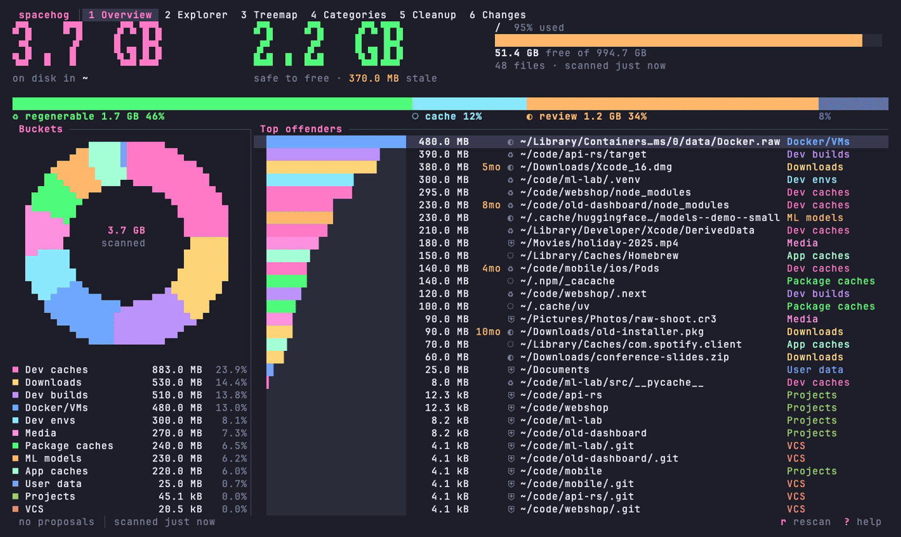

# spacehog

*Find the hog. Feed it to your agent.*

spacehog is a disk-usage tool with two faces on one engine. The TUI shows where your disk went with treemaps, category donuts, and proportional bars. The MCP server lets an AI agent ask the same engine what is eating the disk, propose a cleanup, and run it once you approve.

It knows what `node_modules`, `target/`, `__pycache__`, Go build caches, Docker images, and Xcode DerivedData are. It knows whether each one can be regenerated and how stale the project that owns it is. Nothing leaves your machine: spacehog makes no network calls, and a test runs every command with the network denied to prove it.

<!-- GIFs -->


Every recording runs against a synthetic home built by `scripts/demo-tree.sh`; regenerate them with `vhs docs/<name>.tape`.

- [Overview](docs/overview.gif): totals, what is safe to free, buckets, and the largest offenders.
- [Treemap](docs/treemap.gif): a squarified map of any folder; `enter` zooms in, `backspace` zooms out, `+`/`-` change depth.
- [Categories](docs/categories.gif): every rule grouped by bucket with stale totals; select paths and queue them.
- [Cleanup](docs/cleanup.gif): your queue and agents' proposals, approved and moved to the Trash with live progress and undo.
- [Changes](docs/changes.gif): what grew and shrank between two scans.

## Install

```sh
cargo install --path crates/cli
```

A Homebrew formula for a personal tap is in [packaging/homebrew/spacehog.rb](packaging/homebrew/spacehog.rb). spacehog is built and tested on macOS and Linux.

## Quick start

```sh
spacehog                 # open the TUI; the first run scans your home directory
spacehog ~/code          # scan a folder, then open the TUI
spacehog summary         # bytes per category
spacehog top --category dev-caches --stale 90d
spacehog explain ~/code/old-app/node_modules
spacehog clean --category node-modules --stale 90d --dry-run
```

The first scan of a large home directory takes a while (see [Performance](#performance)). After that, every query, from the TUI, the CLI, or an agent, reads the index and answers in milliseconds.

## Commands

| Command | What it does |
|---|---|
| `spacehog [path]` | Open the TUI, scanning `path` first if given. `--changes` opens on the Changes view. |
| `spacehog scan [path]` | Walk a tree and write it to the index. `--all-filesystems` crosses mount points. |
| `spacehog top` | Largest categorised items. Filter with `--category`, `--stale 90d`, `--safety regenerable,cache`, `--under`, `--min-size`. |
| `spacehog summary` | Bytes per bucket and the largest rules. |
| `spacehog explain <path>` | The rule that claimed a path, why it is or isn't stale, its safety class, and how to regenerate it. |
| `spacehog clean` | Propose, confirm, and execute a cleanup. `--dry-run` shows what would go. `--permanent` deletes instead of trashing and always asks you to type the total. `--yes` skips the prompt and is refused with `--permanent`. |
| `spacehog undo <journal>` | Put back everything a cleanup moved to the Trash. |
| `spacehog changes` | What grew or shrank since the previous scan, or `--since 7d`. Alias: `what-changed`. |
| `spacehog proposals` | List agent proposals; `approve <id>` or `reject <id> --reason "…"`. |
| `spacehog status` | Disk volumes, the last scan, and pending proposals. |
| `spacehog rules` | The active rule set; `--print-default` prints the embedded `rules.toml`. |
| `spacehog mcp` | MCP server over stdio. `mcp install` configures clients. |

Every command takes `--json`. Exit codes: `0` success, `1` error, `2` usage error, `3` no scan in the index yet, `4` refused by a safety rule, `5` a scan is already running.

## How spacehog decides what is safe

Every byte belongs to a bucket (Dev caches, Package caches, Docker/VMs, Projects, Media, and so on) and every claimed item has a safety class:

| Class | Meaning | What cleanup does |
|---|---|---|
| `regenerable` | A tool rebuilds it on demand; losing it costs time, not data. | Agents may propose it. |
| `cache` | An app or tool cache. | Agents may propose it. |
| `review` | Probably fine but could hold your work, such as Downloads or old toolchains. | Agents may propose it only once it has been idle 30 days. The TUI asks you to confirm each item. |
| `protected` | Your data, your source code, apps, and anything no rule claims. | Never proposed, never deleted. |

Staleness is measured from the project, not the artefact. `node_modules` in a project you edited yesterday is not stale, however old the folder itself is. spacehog takes the newest of the project's manifests, lockfiles, sibling files, and `.git/HEAD` and `.git/index`.

Cleanup re-checks every item immediately before deleting it, and skips it if its inode, type, or size changed since the scan. It never deletes the scan root, your home directory, a mount point, a directory that holds a `.git` repository, or a symlink's target. Items go to the Trash by default. Every deletion is journaled to SQLite and to `~/.local/state/spacehog/journal.jsonl`, and `spacehog undo` reverses a trash cleanup.

## Let Claude clean your disk

`spacehog mcp` serves the engine to MCP clients over stdio. Print the config for Claude Code, Claude Desktop, and Cursor:

```sh
spacehog mcp install                          # all three snippets
spacehog mcp install --client cursor --write  # merge into ~/.cursor/mcp.json, backing it up first
```

For Claude Code, run the `claude mcp add spacehog -- <path> mcp` line it prints. `--write` covers Claude Desktop and Cursor, keeping every other server in the file.

The agent gets `status`, `scan`, `summary`, `top`, `query`, `explain`, `changes`, `propose_cleanup`, `list_proposals`, `execute_cleanup`, `undo`, and `rules`. The flow is propose, then approve, then execute:

1. The agent finds candidates and calls `propose_cleanup`. Protected paths are rejected with a reason.
2. You approve the proposal in the TUI's Cleanup view or with `spacehog proposals approve <id>`.
3. The agent calls `execute_cleanup` with the proposal's exact total, such as `"28.4 GB"`, as its `confirm` string.

To let agents clean low-risk items without asking, list those safety classes in `mcp.auto_approve`. Permanent deletes always need your approval. Logs go to `~/.local/state/spacehog/mcp.log`; stdout carries nothing but protocol.

[examples/claude-code.md](examples/claude-code.md) is a captured session that frees space after an `ENOSPC`.

## Configuration

`~/.config/spacehog/config.toml`, every key optional ([examples/config.toml](examples/config.toml)):

```toml
default_root = "~"        # what bare `spacehog` scans first
one_file_system = true    # stay on the root's filesystem
theme = "dark"            # or "light"; NO_COLOR is respected
icons = false             # Nerd Font icons
stale_days = 90           # what "stale" means in summaries and the TUI
keep_scans = 5            # scans kept per root for `changes`

[mcp]
auto_approve = []         # e.g. ["regenerable", "cache"]
allow_review = false      # let agents propose review items idle under 30 days

[cleanup]
mode = "trash"            # or "permanent"
max_bytes_per_execution = 100_000_000_000
max_items = 500
```

### Your own rules

`~/.config/spacehog/rules.toml` is read before the embedded defaults (`spacehog rules --print-default` shows them). It can add rules, change a rule's safety class, and protect or allow paths ([examples/rules.toml](examples/rules.toml)):

```toml
protect = ["~/work/client-deliverables"]   # never cleaned, whatever matches inside
allow = ["~/scratch"]                       # treated as cache

[overrides]
js-dist = "regenerable"                     # rule id -> safety class

[[rule]]
id = "unity-library"
category = "dev-cache"
label = "Unity Library cache"
name = ["Library"]
sibling = ["ProjectSettings"]
safety = "regenerable"
regen = "reopen the project in Unity"
stale = "project"
```

## How it works

```
 TUI (ratatui)     MCP server (rmcp)     CLI (clap)
       \                 |                  /
        +----------- spacehog-core --------+
        | scanner -> categoriser -> index  |
        | query, diff, proposals, executor |
        +----------------------------------+
                         |
              SQLite in WAL mode (index.db)
```

The scanner walks in parallel on rayon; on macOS it lists each directory with `getattrlistbulk`, one syscall per batch of entries. The rule engine claims subtrees top-down, and fallback rules (app data, user folders, project roots) keep descending so caches nested inside them are still found. Nodes are stored in pre-order, so "everything under this path" is an id range. The TUI and the MCP server are separate processes sharing that database: an agent's proposal appears in the TUI within two seconds (half a second while the Cleanup view is open), and approving it there is what lets the agent execute it.

Design decisions and the measurements behind them are in [docs/decisions.md](docs/decisions.md).

## Performance

Measured on an M-series MacBook (2026-11-06):

| Tree | Files | Walk | Categorise | Index write | Peak RSS | `top --json` |
|---|---|---|---|---|---|---|
| `~/.rustup`, warm | 163k | 0.24 s | | | | |
| projects folder, warm | 1.77M | 6.7–6.9 s | 0.32 s | 5.7 s | 695 MB | 10 ms |
| whole `$HOME` | 15.6M | 72 s | 1.8 s | 62 s | 4.4 GB | 18 ms |

The projects row is three first scans into a fresh index, each 13.0 to 13.5 s from start to a ready Overview. A rescan into an existing index took 16.1 s, because the write also compacts the previous scan of that folder. The `$HOME` row ran while other builds were using the machine, so read it as an upper bound. On that home directory, 8.5% of bytes fell in `other`; everything else was categorised.

## Licence

MIT
